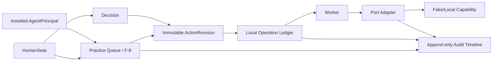

# Canonical architecture contract

Status: proposed contract requiring Cursor Phase 0 validation  
Date: 2026-09-02  
Version: 1.9-draft

## 1. Product definition

Cosmas OS is an internal-first practice computer for a small healthcare
organization. It hosts human seats and installed agent capabilities around one
shared approval-and-action substrate.

The first product slice proves that a practice can see work, understand the
proposed action, approve or correct it, execute it safely, and reconstruct what
happened. It does not attempt to deliver the whole AI employee vision at once.

V1 commercial and workflow position:

- Flat SaaS; exact price and packaging remain open.
- Insurance ArtifactChase is the first external-shaped workflow.
- Payment recovery and PAN handling are absent.
- The first implementation is entirely synthetic and local.

## 2. System shape

Use a modular monolith with explicit domain ports. Do not begin with
microservices.



Likely implementation units, subject to Phase 0 validation:

```text
src/cosmas_os/
  domain/          entities, value objects, transition and policy rules
  application/     use cases and transactions
  ports/           interfaces with no vendor nouns
  adapters/        local/fake implementations first
  api/             FastAPI and OpenAPI boundary
  worker/          operation execution and reconciliation
web/               smallest useful owner/approver queue
migrations/
fixtures/synthetic/
tests/{unit,integration,contract,e2e}/
infra/{local,azure-beta}/
```

## 3. Org equals Box

An Org is a legal practice/covered-entity or BAA-scoped boundary. Each Org owns
one logical Box.

A Box contains:

- immutable Box identity;
- human seats and installed agents;
- policies and capability levels;
- queue and workflow state;
- authoritative operation ledger;
- data and artifact references;
- audit history.

The Box is not one VM per user and does not require one permanent full cloud
stack per small practice.

### 3.1 Bootstrap

Provisioning atomically creates:

1. `BoxContext` with one immutable Box/Org ID (`box_id` is the system form of
   the Org ID, not a second tenant identifier);
2. initial owner `HumanSeat`;
3. owner authority grant;
4. baseline agent installations;
5. initial audit event.

The owner-seat binding is the bootstrap authority. The Box identity is the
permanent audit root and survives ownership transfer.

### 3.2 Scope rules

When a database/schema and storage identity are exclusive to one Box, child
domain rows may inherit that context without repeating `org_id`.

Box scope must be explicit at every boundary that is or could become shared:

- audit export and centralized telemetry;
- blob namespaces and metadata;
- backups and restores;
- centralized queues or schedulers;
- support/admin tools;
- network coordination;
- cross-repository calls;
- any future shared database.

Moving multiple Boxes into one shared database is a new architecture decision.
It requires enforced tenant keys and isolation before migration.

## 4. Principal model

Use a common `Principal` identity envelope with non-interchangeable types.

### 4.1 HumanSeat

- Bound to one human login; eventual real identity uses Clerk.
- May hold owner, approver, provider, biller, or staff grants.
- May approve only work lanes permitted by policy.
- Clinical submissions require an appropriate licensed clinician.
- At least one active owner remains; transfer precedes owner removal.

### 4.2 AgentPrincipal / AgentInstallation

- Installed Scribe, Chief, Chaser, or later capability.
- Cannot authenticate as a human.
- Cannot create its own human approval.
- Cannot sign or submit a system-of-record action as a human.
- Has pinned agent, charter, specialty-overlay, and configuration versions.

Baseline agents may be present by default. An owner may disable or remove them
from active use. Internally, removal tombstones the installation so historical
events remain understandable. Reinstallation creates a new identity/version.

### 4.3 Policy precedence

```text
non-removable platform safety policy
-> universal agent charter
-> specialty policy overlay
-> Org-owner configuration
```

Lower layers may narrow but not expand authority. Deny wins. Historical events
pin the policy versions that governed them.

Never-matchers may run before model generation. Deterministic authorization is
also enforced at the action gateway. Model output is never authorization.

## 5. F-8 shared workflow

F-8 is the sole user-facing work and decision state machine. A feature
contributes detection and domain context; it does not create a private approval
queue.

Authentication, reads, and inbound observations do not require human approval
merely to occur. They remain Box-scoped and auditable and may create F-8 work.
Outbound side-effecting mutations pass deterministic authorization and the
operation ledger. This keeps routine internal observation from becoming
approval-heavy.

Separate the following concepts:

```text
Ticket
  work context and desired outcome

ActionRevision
  immutable proposed target, action, content and policy snapshot

Decision
  approve, edit, reject, or escalate by a HumanSeat

Operation
  durable execution intent and result

AuditEvent
  append-only reconstruction record
```

Recommended lifecycle:

```text
DRAFT
  -> PENDING_APPROVAL
  -> APPROVED | REJECTED | ESCALATED

EDIT creates a new ActionRevision and invalidates prior approval.

APPROVED
  -> Operation PENDING
  -> RUNNING
  -> SUCCEEDED | FAILED | UNKNOWN

Feature outcomes may continue through SENT -> CONFIRMED -> CLOSED.
```

No mutable draft executes. Approval pins:

- Box and action revision;
- intended target/reference;
- action type;
- template and content revision;
- canonical payload hash;
- policy/charter/config versions;
- approving human and time.

For initial patient outreach, an exact revision or displayed batch of exact
revisions requires human approval. Ticket-list acceptance does not silently
authorize later changed messages. Standing template automation remains dark.

### 5.1 Concurrent approval and editing

`Ticket` and `ActionRevision` use optimistic versions. The approval transaction
confirms that the proposed revision is still current and
`PENDING_APPROVAL`; concurrent double approval returns the existing decision
and operation.

Normal editing occurs before approval and creates a new current revision. If an
approved operation is still `PENDING`, an explicit compare-and-swap cancellation
may withdraw it before a worker claims it. Once an operation is `RUNNING`,
`SUCCEEDED`, or `UNKNOWN`, editing cannot retroactively retract its effect; a
new corrective ticket/action is required. The UI must explain that boundary.

## 6. Local operation ledger and retry safety

Postgres is authoritative. Redis/Celery may transport work but is not the
business record.

Approval and operation creation occur in one database transaction. The minimum
operation includes:

```text
operation_id
action_revision_id
idempotency_key
adapter
status
attempt_count
external_reference
result_or_receipt_hash
created_at
started_at
completed_at
```

Rules:

- Payload hash binds approval but is not the sole idempotency key.
- Repeated clicks and worker retries reuse the same operation.
- Payload changes require a new revision and approval.
- Use the stable operation ID as vendor idempotency key when supported.
- A scanner may re-enqueue authoritative pending operations after broker loss.
- A potentially successful but unconfirmed call becomes `UNKNOWN` and enters
  reconciliation rather than blind retry.
- Unique constraints allow one operation per approved action intent.

The promise is retry-safe execution and explicit uncertainty handling, not a
generic claim of mathematically exact-once external delivery.

No Kafka, Azure Service Bus, or generalized event platform is needed for L0.

## 7. Minimum domain and audit model

| Entity | Minimum purpose |
|---|---|
| `BoxContext` | Singleton Box/Org identity, state, creator, timestamps; no second tenant ID |
| `Principal` | Stable human/agent identity, state, tombstone metadata |
| `HumanSeat` | Login subject and role/authority grants |
| `AgentInstallation` | Agent key/version, charter/config versions, enabled state |
| `CharterVersion` | Immutable layer/scope/rules/hash/effective time |
| `CapabilityConfigVersion` | Enabled ports/rungs and activation evidence |
| `Ticket` | Lane, state, source references, creator, approver policy |
| `ActionRevision` | Immutable action, target, content reference/hash and policy snapshot |
| `Decision` | Human actor, revision, decision and timestamp |
| `Operation` | Stable execution identity, adapter, attempts, state and receipt |
| `AuditEvent` | Append-only event envelope |
| `Artifact` | Blob reference, checksum, classification, retention and purge receipt |
| `PatientLink` | Attested stable source-pair references, provenance, confirmer, state and revocation |
| `AppointmentObservation` | Source-specific appointment observation |
| `AppointmentProjection` | Reconciled working appointment state |
| `OutboundMessage` | Sender, channel, approved revision and delivery receipt |

The protected audit journal stays inside the Box and may hold the minimum
references required to reconstruct authorized work. Ordinary logs and
centralized telemetry contain only opaque IDs, event classes, timing, and
outcomes - never payloads, patient/source identifiers, signed URLs, content
hashes that reveal a purged object, or blob paths.

An exported audit envelope includes:

```text
event_id
box_id
aggregate_type + aggregate_id
event_type
actor_principal_id
initiated_by_principal_or_trigger
approved_by_principal_id when applicable
action_revision_id
payload_hash
policy/charter/config versions
correlation_id + causation_id
opaque source references where authorized; no signed URL
timestamp
outcome
external receipt/reference
```

A purge receipt records only the artifact's opaque internal ID, retention rule,
deletion time, and outcome. It contains no patient identifier, original blob
path, source-system identifier, or deleted-content hash.

Deleting or disabling a human or agent never deletes its historical identity.

## 8. Ports and ladders

External systems are reachable only through ports. Outbound side-effecting
adapter operations may not bypass deterministic authorization or the operation
ledger. Auth checks, reads, and inbound observations are scoped and audited but
do not require an artificial human approval or operation merely to be observed.

| Port | Initial ladder |
|---|---|
| `AuthPort` | Local synthetic identity; Clerk only in a later real environment |
| `SchedulePort` | L0 CSV/manual; L1 read; L2 governed two-way |
| `RecordPort` | L0 local draft; L1 read; L2 document attach; later governed writes |
| `NotifyPort` | L0 in-app/fake sink; L1 patient secure-link email; L2 A2P SMS |
| `BlobPort` | Local synthetic store; later isolated Azure Blob |
| `PayPort` | SaaS subscription boundary only; patient payment deferred |
| `EvidencePort` | Off until an isolated retrieval design is approved |
| `WorkbookPort` | Deferred from the first slice |

Each adapter declares its supported rung. Unsupported methods fail closed.

ArtifactChase L0 may finish at `IMAGE_ON_FILE` plus human verification. It must
not claim eligibility. A human-attested `PatientLink` is required before a
chase proceeds. Attestation persists for a stable source-pair and is repeated
only after ambiguity, changed identifiers, supersession/merge, or revocation;
it is not a mandatory click on every chase.

## 9. First vertical slice

The first build, after owner approval, is a deterministic synthetic Insurance
ArtifactChase:

1. Seed one fake Box, owner/approver, and baseline agents.
2. Import synthetic appointments through `SchedulePort` L0.
3. Attest a synthetic `PatientLink`.
4. Detect a missing insurance artifact.
5. Create an F-8 ticket and neutral message revision.
6. Approve, edit, reject, or escalate in one owner queue.
7. Execute through the local operation ledger and fake `NotifyPort`.
8. Simulate a patient upload using synthetic front/back images.
9. Require human verification and mark `IMAGE_ON_FILE`.
10. Close the ticket and display the audit timeline.
11. Purge the working copies using an injectable/test clock and retain a
    non-PHI deletion receipt.

No real message, patient, Clerk user, vendor, Azure service, or application LLM
is involved.

## 10. Capability-gated compliance and usability

Base controls are invisible platform defaults:

- authenticated principal boundary;
- Box-scoped execution/storage;
- deterministic authorization;
- append-only audit;
- safe logs;
- secret isolation;
- backup/restore capability;
- retention/deletion mechanism.

Optional capabilities carry activation manifests describing handled data,
processors, prerequisite agreement/configuration, consent, retention, required
port rung, approval class, and activation evidence.

Examples:

| Capability | Gate applies only when enabled |
|---|---|
| Scribe recording | Consent UX and audio lifecycle |
| Patient email/SMS | Channel configuration, consent/opt-out, neutral body and secure link |
| Insurance upload | Token protection, upload validation and purge |
| Athena/Acuity | Access, scopes and reconciliation |
| External model | Applicable agreement and approved configuration |
| Evidence retrieval | Separate untrusted zone and controlled citation boundary |
| Payment | Separate approval, tokenized processor and zero PAN |

The practice sees work, people, agents, and outcomes - not `box_id`, queue
internals, operation IDs, or compliance jargon. Setup remains choose agent,
choose approver, enable channel, confirm practice policy.

## 11. Environment boundaries

### `synth_os`

- New repository and Docker Compose.
- Synthetic fixtures only.
- Fake adapters, optional local mail sink.
- Zero PHI, vendor access, or production credentials.
- Cursor/multi-agent development allowed.

### `early_adopter_beta`

- Isolated OS environment and first Box.
- Dedicated deployment identity and Clerk Org.
- Human deployment.
- Lowest useful port rungs.
- Only enabled capabilities trigger additional prerequisites.
- No coding-agent access to live PHI or credentials.

### `cosmas_mcd_prod`

- Owned by Track A.
- No direct OS database, secrets, Terraform state, or service principal.
- Later integration through a versioned authenticated contract.
- Human-reviewed integration after the Track A IAM gate.

## 12. Track A integration contract

Track A remains independently usable when OS is unavailable. OS retains work
safely when Track A is unavailable.

Integration rules:

- HTTPS/OpenAPI or bounded first-party MCP only;
- no direct database or migration ownership across repositories;
- no source imports or shared production principal;
- receiver-first, backward-compatible contract changes;
- `correlation_id`, `box_id`, actor, operation ID and outcome cross the boundary;
- PHI stays out of ordinary logs;
- fake adapter in synth until Track A deliberately exposes the receiver.

Likely future candidates are an authenticated Scribe stream-ingest contract and
`soap.draft`. Their existence and shape must be verified; they are not assumed.

## 13. Required invariant tests

- A principal outside a Box cannot read or execute within it.
- Ownership transfer preserves the Box audit root, and the last active owner
  cannot be removed without a successor.
- An `AgentPrincipal` cannot produce a human approval or sign.
- A removed agent cannot create new work; history remains readable.
- Deny wins across policy layers, and each action pins the exact policy,
  charter, and configuration versions used.
- Editing an action invalidates its approval.
- Concurrent approve/edit and double-approve cannot execute two revisions.
- Executed payload hash equals approved payload hash.
- Duplicate click and retry return the existing operation.
- Broker/worker failure resumes the authoritative operation.
- Unknown outcomes reconcile rather than blindly repeat.
- Patient chase is blocked without an attested `PatientLink`.
- `AUTO_DRAFT` cannot leave the staff surface.
- No feature creates a private approval queue.
- The L0 workflow completes with every external adapter fake or disabled.
- Due working copies purge and produce deletion receipts.
- Fixtures contain no PHI or production credential.

## 14. Technology hypothesis, not conclusion

Cursor must validate the smallest compatible implementation. Starting evidence
suggests FastAPI, Postgres, SQLAlchemy/Alembic, Celery/Redis, Docker Compose,
Pytest, React/React Router or a simpler queue UI, and later Azure Container Apps.

Known version tension: the human roadmap says Python 3.12 while the recently
observed legacy `pyproject.toml` requires Python 3.13. Phase 0 must resolve this
with current evidence before scaffolding.

GPT-5.6 SOL is the development agent, not a runtime product dependency.
