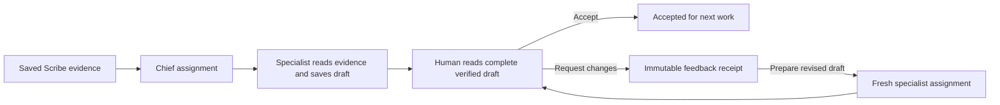

# Operational agent and human review loop

Chief can prepare private assignments from the encounter's selected saved sources.
An enabled tool contract also lets bots read those exact sources, lets Chief read
its completed teammates' drafts, and lets Chief check saved operation status.
These readers do not send messages, change appointments, deliver documents,
grant connector access, or establish that clinical care occurred.



Review binds the completed attempt, full result hash, original selected passages,
workspace owner and current team. Each attempt receives one immutable decision.
Requesting changes saves feedback; the separate **Prepare revised draft** action
queues fresh work. The prior draft and feedback are supplied in full, within the
12,000-character request bound. At most three consecutive revisions are allowed.
Acceptance remains separate from clinical sign-off and external action approval.

Changed sources or team settings invalidate a decision for next work. Historical
receipts remain recoverable. The interface carries retained changes into an
editable fresh Chief request, without automatically sending it. Definite refusals
allow a fresh read; uncertain saves retain the same payload and idempotency key.
Access denial withholds the private draft.

Review replies use the `handoff_review:2` wire contract. An exact public command
hash confirms the original review even if a selected email becomes unavailable
after the save. Such replies explicitly withhold feedback/result contents and
remain historical receipts; the interface cannot use them to authorize a new
assignment or external action.

## Activation and limits

`WORKSPACE_AGENT_TOOLS_ENABLED` defaults to false. When explicitly enabled, new
ordinary conversation and private assignment admissions use
`cosmas-gpt41-prepared.v5`; existing v1–v4 requests retain their pinned decoding.
Research, Inbox, Membership and Session Prep analysis retain their own contracts.
Turning the tool flag off stops reads on already admitted v5 work.

Tool metadata freezes entry IDs, revisions and hashes before dispatch. A reader
checks active owner, bot, team, lease and source selection before and after the
read. Agent and initiating human identities are distinct. Audit receipts contain
hashes and scope metadata rather than source or reply contents. Each attempt is
bounded to four tool calls, three provider rounds and 60 seconds. No uncertain
provider request is automatically repeated.

Unconfirmed review commands currently survive while their editor remains open;
encrypted command recovery across process termination is a remaining release
acceptance requirement. A matching backend schema and native/web release are
required before operational rollout.

## Repeatable synthetic qualification

Use the existing development Python environment and PostgreSQL 16:

```sh
python scripts/check-backend-local.py --profile workspace \
  --postgres-bin /path/to/postgresql/bin \
  tests/integration/test_handoff_review.py \
  tests/integration/test_agent_tools.py \
  tests/integration/test_product_agent_tool_workflow.py \
  tests/integration/test_agent_operation_status.py \
  tests/integration/test_handoff_ui_server_lab.py
```

The product UI server lab runs six journeys: provider, nurse practitioner and
physician assistant, each twice. It mounts the product review controls, calls
FastAPI over an owned loopback bridge, uses PostgreSQL and executes the actual
product model/tool worker. Its only injected operational boundary is the upstream
model response. Every journey requests changes, runs a fresh specialist assignment,
accepts the exact revised draft and confirms it with an independent read.

These checks establish local workflow and failure recovery, not physical-device
usability, clinical accuracy, live connector delivery, actual model performance,
or public-launch readiness. The Node runtime path is explicitly pinned in the
Python UI lab; a missing runtime fails qualification rather than silently skipping.
