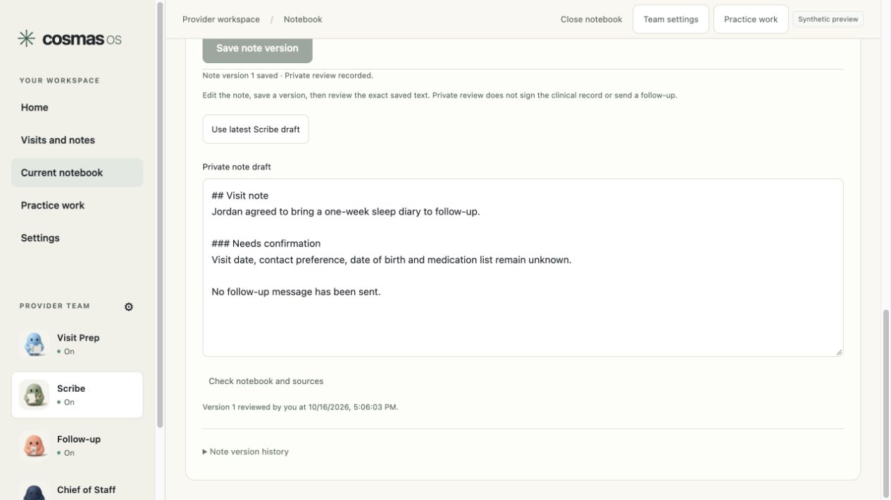

# CosmaBot desktop UI/UX implementation and acceptance

Completed October 16, 2026 for the owner's approved local implementation and synthetic testing. All six batches are implemented. The code, working previews, screenshots and test evidence are ready for review.

The supplied Claude handoff and design prompts were treated as reference material. The owner's direct approval authorized this implementation and superseded the repository's historical initial-build phrase gate. Existing authorization, exact-operation recovery, source review and synthetic-only restrictions remain in force. Work stayed within this conversation.

## Deliverable

- Repository: `CosmaNeura/cosmaneura-os`.
- Baseline: `c12f2ddac5d68ee19be2b4cd408971ab148fc113`, retrieved from current GitHub main on October 16.
- Integration branch: `codex/cosmabot-ux-20261016`. The owner requested integration into GitHub main after the completed local review.
- Desktop delivery: `~/Desktop/Cosmas/cosmabot-ux-20261016`.
- Validated execution copy: `/private/tmp/cosmabot-ux-execution-20261016`. Desktop file reads stalled TypeScript and Git during initial validation; the complete local execution copy restored normal checks. The completed source and evidence are synchronized to the Desktop delivery.
- Actual-component workspace preview: [127.0.0.1:5196](http://127.0.0.1:5196/).
- Connection-state preview: [127.0.0.1:5187](http://127.0.0.1:5187/).

Both previews are isolated, clearly labeled synthetic adapters around the production components. The workspace preview uses generated PCM through the real encrypted recording controller and local storage. It never opens the physical microphone. Unsupported service operations fail or explain their unavailable receiver. They do not simulate account sign-in or external delivery.

## Completed batches

| Batch | Implemented result | Claude findings | Acceptance evidence |
| --- | --- | --- | --- |
| 1 Reliable editing and recovery | Stable immediate text state; debounced encrypted persistence with exit flush; panel-owned recovery; bounded HTTP waits; retained exact requests; obsolete success cleared on failed refresh | F1–F4, F7 | Slow persistence, focus/cursor, 503, dropped response, stale refresh and duplicate-operation checks |
| 2 Shared shell and notebook | Slim header and persistent sidebar; opaque-ID routes; shared helper notebook; Before/Visit Prep, During/Scribe, After/Follow-up; explicit Notes → Draft → Review → Saved; safe Markdown; provenance labels; keyboard menus and dialogs | F9, F16, F19, F20, F24, F26, F27, F30, F33–F35 | Full frontend suite; signed save/reopen journeys; browser draft/edit/save/review; route and keyboard tests |
| 3 Recording and lists | Explicit recording states and permission guidance; timer and transient signal meter; persistent Return/Pause/Stop controls; durable title metadata; owner-only summaries; Home and Visits search, filters and row actions | F5, F8, F17, F18, F28 | 550 capture tests; signed encrypted PCM capture/reopen; permission and physical-stop simulation; recording-on-Home screenshot |
| 4 Team and profile | Flat About/Permissions/Sources; default jobs and required-job validation; normalized field diffs; unsaved exit choices; remove draft additions/retire saved coworkers; seven structured practice preferences | F6, F7, F10–F12, F25, F29, F31, F32 | Team/profile backend and frontend checks; browser focus, unsaved dialog, profile and narrower layout review |
| 5 Connections and practice work | One connection headline and primary action with separate service proof; accurate setup/Coming soon; owner-reviewed invitations; work tabs and filters; compact Daily brief schedule and latest saved brief | F13–F15, F21, F23 | Signed invitation/create/join/approve/revoke and membership pause/restore; connection failure isolation; work/routine operation tests |
| 6 Sample and provider acceptance | Signed-in Home sample with actual agenda, public reference brief and editable follow-up draft; complete synthetic provider journeys; visual/keyboard/contrast review | F22 and regression coverage | Physician/NP/PA specialist journeys, two rounds each; 14 screenshots; 1090px, 1507px and 768px layouts; builds/typechecks |

## Behavior and data boundaries

Typing and background operations are independent. Slow local persistence does not disable a focused notebook or team field. Storage failures preserve the working text and expose recovery. Debounced writes flush on close; discard cancels the pending local write. Uncertain server operations retain their original request and must be resolved before replacement. Browser timeout or leaving a panel does not claim to cancel a server write.

The notebook is shared across helpers, with explicit phase selection and one draft action. That action saves the intended jottings before requesting Scribe's draft. Incoming drafts cannot overwrite edited review text. Local autosave, saved note versions and recorded private review have distinct receipts. Review remains bound to the exact saved text and source commitment. Safe Markdown suppresses raw HTML, remote images and unsafe links; internal provenance stays attached to saved source records. Enter/Shift+Enter and text composition have separate behavior. Patient names and clinical content are excluded from routes.

Recording retains the existing consent wording exactly: “I informed everyone that this conversation will be recorded and every party gave consent for this recording.” Permission help appears after 15 seconds without treating ignored permission as consent. Late permission still allows a physical Stop, and unconfirmed stop remains visible. The same controller stays mounted while browsing Home, Visits or Settings. Pause retains Stop & save. Local recording and later upload to Scribe for transcription are described separately. No screen reports durable audio or server sync before its receipt exists.

Notebook titles use append-only owner-authorized display revisions. Renaming does not rewrite clinical revisions, recording manifests, PCM, capture hashes or ledger proof. An encrypted device title overlay preserves the original recording manifest. List projections use actual timestamps, linked visit details, known durations and review states. Missing dates remain unknown; ordinary calendar events are not promoted into clinical appointments.

Team changes compare normalized fields rather than raw JSON: omitted defaults, optional empty values and reordered sets do not manufacture edits. Save describes actual before/after fields and explains invalid or unchanged drafts. Required jobs block accepting incomplete additions. Removing a saved coworker retires the active configuration while preserving historical identity and assignments. Exit offers Save, Discard, Keep editing, or Keep draft and continue; an uncertain save cannot be silently discarded.

The structured profile adds practice name, specialty, provider name, credentials, state, note format and language. It preserves legacy practice instructions and the existing 1,000-character helper-context budget. Team configuration contract 5 prevents older clients from dropping these fields. Preferences grant no new capability.

Invitations are separate from the existing identity matching code. A verified active owner in the configured practice creates a bounded invitation with 24/72/168-hour expiry. The client generates a 256-bit secret; the server stores only its SHA-256 hash. Creation, join and revocation use exact request commitments and resolve/retry recovery. The recoverable client secret has narrowly scoped encrypted journal custody. Links use a fragment, and joins create a request for owner review rather than membership. Expiry, revocation, immutable use receipts and composite practice/owner constraints prevent cross-practice or replay shortcuts. No email was sent and no clinical capability was broadened.

Practice work keeps its existing operation and review contracts. Messages, Follow-ups and Assigned to me expose real rows, searchable ownership/outcomes, status filters and available actions. Pending items stay visible while their operation is unresolved. Daily brief displays its helper, saved schedule/timezone, on/off state and latest saved result through the existing routine contract. Connection cards distinguish account sign-in from verified email/calendar reads in their details. A failed Microsoft check leaves Google and practice sections usable.

## Backend and migration changes

The complete migration chain was applied to isolated local PostgreSQL 16. The final main schema head is `e3a90d77b812`:

1. `c1e5a64f9201_notebook_display_titles.py`: immutable notebook title history.
2. `d2f7b89013a4_practice_invitation_history.py`: invitation, use and revocation history.
3. `e3a90d77b812_invitation_scope_constraints.py`: composite owner/practice/request constraints.

The runtime schema expectation and the local candidate release schema selection agree with that head. This repairs the source/runtime schema consistency checks; no hosted migration or infrastructure apply occurred. Metadata/private-draft routes remain owner-only and withhold identifying summaries after revocation. Bounded storage failures retain the `workspace_storage_unavailable` 503 response; capability/client compatibility errors remain distinct. The supplied staging 503 cannot be attributed to a particular adapter or database from the screenshot alone. Public staging manifests were inspected but could not be matched to a source commit, so this work makes no claim that staging is repaired.

## Validation

| Check | Final result | Evidence |
| --- | --- | --- |
| Full frontend | 3,784 passed; 103 skipped; 279 test files passed | [web-full.log](validation/web-full.log) |
| Full retained capture | 550 passed across 39 files | [capture-full.log](validation/capture-full.log) |
| Signed backend and changed contracts | 196 passed | [signed-backend.log](validation/signed-backend.log), [JUnit](validation/signed-backend-junit.xml) |
| Runtime migration/privilege checks | 24 passed | [runtime-privileges.log](validation/runtime-privileges.log) |
| Compact authority/isolation | 23 passed | [compact-isolation.log](validation/compact-isolation.log) |
| Web and capture TypeScript | Passed | [web-typecheck.log](validation/web-typecheck.log), [capture-typecheck.log](validation/capture-typecheck.log) |
| Normal web and both previews | Passed | [web-build.log](validation/web-build.log), [acceptance-build.log](validation/acceptance-build.log), [connections-build.log](validation/connections-build.log) |
| Visual and keyboard acceptance | Reviewed at 1090, 1507 and 768px; no horizontal overflow at the narrower tested width; focus trap/Escape/restore verified | [Screenshots](screenshots), [summary.json](validation/summary.json) |

The frontend skips include signed API labs that require an explicit backend fixture. The relevant labs were run through their Python bridges against the migrated local database, rather than being counted as ordinary frontend passes. Signed request validation, exact server writes, source custody and database assertions use the actual application paths. Provider responses, speech recognition and source PCM are explicitly scripted synthetic adapters.

The signed capture journey started generated microphone frames before a three-second private-create response, stopped durably, reopened identical WAV bytes and checked the actual ledger. Six specialist episodes exercised physician, NP and PA personas twice each through Scribe source review, Chief assignments, Follow-up, Research and Visit Prep. These personas are scripted tests rather than real users. Invitation evidence verifies one create, join, use and revocation with matching-code approval and denied reopening while paused. See the [private Scribe](validation/private-scribe-journey.json), [specialist](validation/specialists-journey.json), [Home/note](validation/home-note-journey.json) and [practice access](validation/practice-access-journey.json) reports.

A preliminary broad backend run had 4,514 passes, 26 failures and 31 skips. Two changed UI journeys subsequently passed in the final signed run, and two schema consistency failures were corrected and passed. The remaining 22 failures also reproduce on an unchanged `c12f2dd` source snapshot: ten agent-tool mock/envelope cases, one capture-deadline mock, five research-admission mocks and six host/order-dependent runtime-hardening fixture cases. The unchanged-source broad run had 4,471 passes, 25 failures and 31 skips, including the two old schema failures and one additional capture-admission timing case. The preliminary changed run had concurrent source updates; the final 196-test run and unchanged-source comparison both confirmed their source remained unchanged during execution. The broad suite is therefore not reported as green. Exact shared failures are retained in [baseline-failures.txt](validation/baseline-failures.txt).

The normal build reports a large JavaScript chunk warning (about 1.47 MB before gzip). Build output and both TypeScript checks succeed. Primary text contrast is 14.53:1, muted text 5.71:1 on cream, and primary button text 11.69:1. Small labels and pills were darkened after inspection. This is a practical desktop visual/keyboard review, not a formal accessibility certification.

## Review and rerun

From `web/`, use Node 24 and pnpm 9.15.9:

```sh
pnpm install --frozen-lockfile
pnpm test
pnpm build
pnpm ux:acceptance
pnpm ux:lab
```

From `clients/capture/`, run `pnpm test` and `pnpm typecheck`. For backend checks, use the locked Python environment with development, `efax-inbound` and `mcp` extras, PostgreSQL 16 and `scripts/check-backend-local.py`. The exact final backend selections and source fingerprint are in [summary.json](validation/summary.json). That helper prepares, migrates, checks and cleans isolated local test databases.

The workspace preview's [README](../../web/ux-acceptance/README.md) explains its adapters and limits. Use invented information only. It is a layout/interaction review around the actual components; it does not establish live model quality, production account reliability, physical microphone acceptance, native packaging or external message delivery. Hosted rollout and native distribution remain separate release work.

## Screenshot guide

- 01–04: Home, notebook, reviewed note and recording controls retained while browsing Home.
- 05–06: notebook and saved review at the walkthrough's desktop widths.
- 07–10: flat coworker settings, unsaved exit, structured profile and narrower profile layout.
- 11: concrete sample research/follow-up drafts.
- 12–13: separate connection proof and an isolated failed account check.
- 14: final edited note with the recorded private-review receipt.



## Codebase merge validation

The owner requested merging this implementation into the codebase on October 16. GitHub main remained at `c12f2dd`, so there were no upstream code conflicts. The new date projections now explicitly preserve an unknown UTC date when an owner-scoped Core appointment has only a local source time. An added PostgreSQL regression checks both the catalog and linked notebook summary with a correctly reviewed account and patient correspondence.

All changed Python files pass Ruff. The final changed-contract suite passes 193 tests, including the new date regression, and the four signed UI bridge journeys passed in the merge recheck. The complete beta web build passes with operational-beta-v1, synthetic data mode and public example.invalid origins. See [merge-validation.json](validation/merge-validation.json), [contract results](validation/merge-contracts.log) and [beta build](validation/merge-beta-build.log).

Repository-wide Ruff still reports 28 existing errors and Pyright reports 101 existing errors, both reproduced on unchanged source. GitHub main's [existing synthetic CI run](https://github.com/CosmaNeura/cosmaneura-os/actions/runs/38067807377) already failed Ruff, Python tests, web tests and infrastructure validation. The merge does not claim that repository-wide CI is green and does not relax or bypass any checks. Main has no branch protection or applicable branch rules. Its workflows perform synthetic checks and do not deploy.
