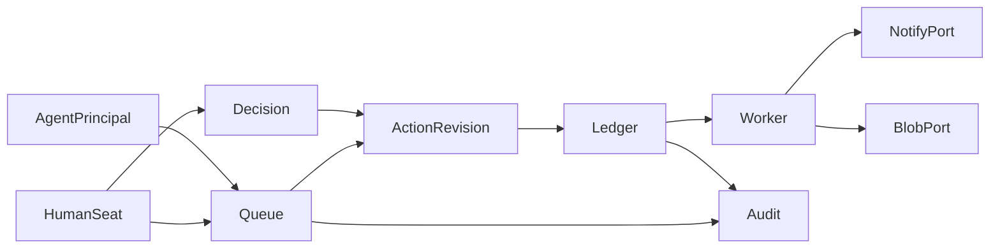

# 03 — Target architecture (validated L0)

Date: 2026-09-02  
Status: validated design for local synth; not an implementation.

## Shape

Modular monolith. Domain and application layers have no FastAPI/Celery/Clerk/Azure/Athena imports. Adapters implement ports. HTTP/UI and worker are thin.

```text
src/cosmas_os/
  domain/         Box, principals, F-8 transitions, policy deny-wins
  application/    use cases / transactions (approve→operation)
  ports/          Auth, Schedule, Record, Notify, Blob, Clock
  adapters/       fake/local only in L0
  api/            FastAPI + OpenAPI
  worker/         claim operation, call adapter, reconcile UNKNOWN
web/              minimal owner queue (React+Vite)
migrations/       Alembic additive
fixtures/synthetic/
tests/
infra/local/      Docker Compose only in first mandate
```



## Box and principals

- One `BoxContext` per Org; `box_id` is the Org’s system ID and permanent audit root.
- Exclusive Postgres database (or schema) for the Box in synth/first beta; child rows inherit Box scope.
- Shared boundaries (logs, future blobs prefixes, backups, support) always carry `box_id`.
- `HumanSeat`: owner/approver grants; fake AuthPort subject in synth.
- `AgentInstallation`: Scribe, Chief, Chaser — disable/remove → tombstone; cannot self-approve/sign/impersonate.
- Last active owner cannot be removed without a successor; transfer preserves `box_id`.

## Policy

```text
platform safety → universal charter → specialty overlay → org config
```

Deny wins. Actions pin charter/policy/config versions.

## F-8 lifecycle

Entities: `Ticket`, `ActionRevision` (immutable), `Decision`, `Operation`, `AuditEvent`.

```text
DRAFT → PENDING_APPROVAL → APPROVED | REJECTED | ESCALATED
EDIT → new ActionRevision; prior approval invalid
APPROVED → Operation PENDING → RUNNING → SUCCEEDED | FAILED | UNKNOWN
feature outcome → … → CLOSED
```

Approval pins: box, revision, target, action type, content revision, payload hash, policy versions, human, time. Optimistic version check on approve; double-approve returns existing decision/operation. Once RUNNING/SUCCEEDED/UNKNOWN, no silent retract — corrective ticket required.

## Approval-to-operation transaction

One DB transaction:

1. Verify revision current and `PENDING_APPROVAL`.
2. Write `Decision(approve)`.
3. Insert `Operation` with stable `operation_id` and uniqueness on approved intent.
4. Append audit events.

Worker uses `operation_id` as retry identity. Duplicate click/retry reuses the same row. Changed payload → new revision → new approval. Unconfirmed external result → `UNKNOWN` + reconciliation, not blind resend.

## Local adapters (L0)

| Port | Adapter |
|---|---|
| AuthPort | Synthetic owner/approver principals |
| SchedulePort | CSV/manual invented appointments |
| RecordPort | Local draft only; no EHR write |
| NotifyPort | In-app/fake sink with deterministic receipts |
| BlobPort | Local filesystem store + secure-token simulation |
| ClockPort | Injectable for retention tests |

Dark: Athena, Acuity, real email/SMS/A2P, Teams, PayPort patient, EvidencePort, WorkbookPort, Clerk, Azure, application LLM.

## ArtifactChase L0 flow

1. Seed Box, owner, Scribe/Chief/Chaser.
2. Import appointments via SchedulePort.
3. Attest PatientLink (blocks chase if missing).
4. Detect missing/stale insurance artifact.
5. Create ticket + neutral message ActionRevision.
6. Owner queue: approve/edit/reject/escalate.
7. Ledger executes NotifyPort once.
8. Simulate front/back upload; human verifies → `IMAGE_ON_FILE`.
9. Close ticket; show audit timeline.
10. Advance clock; purge bytes; retain non-PHI receipt.

## Failure recovery

| Failure | Behavior |
|---|---|
| Crash before worker claim | Scanner/worker reclaims PENDING |
| Crash after adapter success, before commit | `UNKNOWN` → reconcile via receipt/external_reference |
| Broker loss | Re-enqueue from Postgres pending ops |
| Agent disabled mid-flight | No new work; in-flight human-governed |
| Dark capability call | Fail closed |

## Logging / PHI

Ordinary telemetry: opaque IDs, event class, timing, outcome. Never payloads, patient/source IDs, signed URLs, blob paths, or deleted-content hashes. Audit journal inside Box may hold minimum reconstruction references.

## UI constraint

One practice queue. Labels: work, proposed message, approve/edit/reject/escalate, status in plain language, audit timeline. No infrastructure vocabulary in primary flows.
