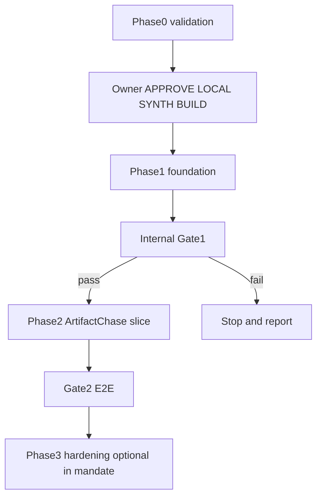

# 04 — Creation roadmap (validated)

Date: 2026-09-02  
Ranges are planning hypotheses. External clocks (Athena, A2P, INV-6) are not engineering estimates.

## Dependency order

One owner phrase authorizes Roadmap Phases 1 and 2. Gate 1 is internal only.

## Phase 0 — independent validation (this package)

| | |
|---|---|
| Duration | 1 focused session (complete) |
| Entry | Handoff present |
| Exit | Eight artifacts + `BUILD_GATE: WAITING_FOR_OWNER_APPROVAL` |
| Confidence | High |

## Phase 1 — local synthetic foundation

| | |
|---|---|
| Duration | ~3–8 focused engineer-days after approval |
| Confidence | Medium-high |
| Stack | Python 3.13, FastAPI, Postgres, Alembic/SQLAlchemy, Celery+Redis, Compose, Pytest, minimal React+Vite queue, local Blob adapter |

### Implement

- Repo init on `main` (local only), README, `.env.example` placeholders
- Box bootstrap; HumanSeat; AgentInstallation tombstones
- Charter/config version pinning; deny-wins
- F-8 transitions; ActionRevision; Decision
- Operation ledger + worker recovery hooks
- Fake ports; synthetic seed kit
- OpenAPI dump; migration on empty DB

### Tests (entry to Gate 1)

Legal/illegal F-8 transitions; agent self-approve reject; last-owner rule; deny-wins; dark capability reject; fixture scan; migrations empty DB.

### Gate 1 exit

One-command start; migrations apply; deterministic fake Box; all tests pass offline; no PHI/prod identifiers in fixtures.

### Scope cuts

No Capacitor, Teams, WorkbookPort/RRM, real Auth, Azurite unless forced, Kubernetes, Kafka.

### Risk

Overbuilding UI or copying master modules → keep queue minimal; mine patterns only.

## Phase 2 — Insurance ArtifactChase vertical slice

| | |
|---|---|
| Duration | ~3–8 additional focused days |
| Confidence | Medium-high |
| Depends on | Gate 1 pass |

### Workflow DoD

Items 1–15 from the master prompt (seed → chase → approve → notify → upload → IMAGE_ON_FILE → audit → purge).

### Required failure demos

Unconfirmed PatientLink; edit invalidation; double-click; worker crash; UNKNOWN; reject/escalate; disabled Chaser; purge retry; concurrent approve/edit.

### Gate 2 exit

No duplicate logical send; no agent self-approval; executed hash matches approval; no infra IDs in normal UI; happy + failure E2E green.

## Phase 3 — usability hardening (within mandate only if Gate 2 early)

| | |
|---|---|
| Duration | ~2–5 days |
| Confidence | Medium |
| Focus | First-run clarity, approval burden, CI honesty, BUILD_REPORT.md |

Stop before any cloud deploy.

## Track A constraints during creation

- No PRs, commits, or shared migrations into legacy repos
- No dependency on `soap.draft` existing
- If staffing conflict: Track A wins; pause Track B

## Kill / reconsider during creation

Gate 1 fails twice on ledger/idempotency; UI cannot hide operation machinery; fixtures require real vendor shapes.

## Owner gestures target

≤7 distinct owner actions for the happy-path demo (see feasibility usability section). Measure and report in BUILD_REPORT.
